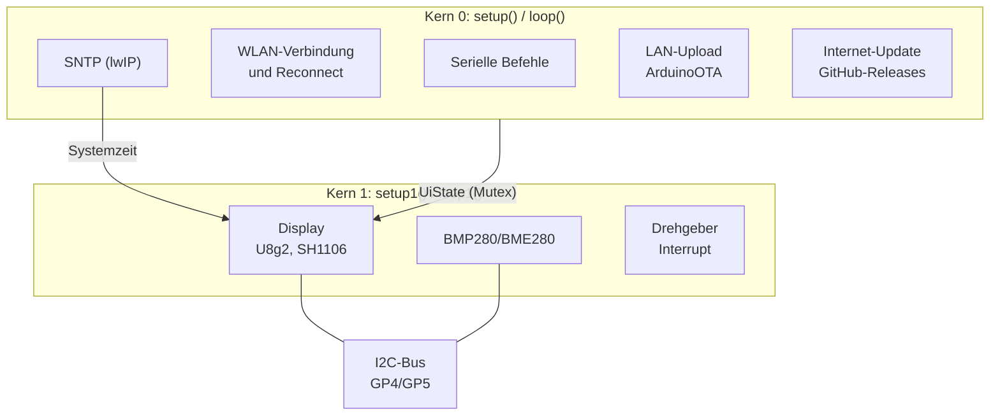
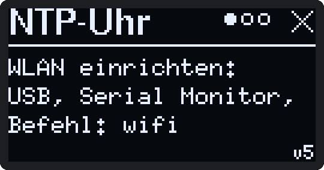
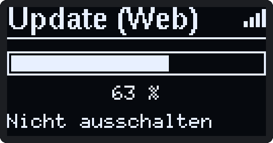

# Firmware

Die Firmware besteht aus einem einzigen Sketch, `wlan-zeit/wlan-zeit.ino`. Sie nutzt den
arduino-pico-Core von Earle F. Philhower und als einzige zusätzliche Bibliothek **U8g2** für das
Display. Den Sensor liest ein eigener kleiner Treiber im Sketch aus.

## Kompilieren und Hochladen

**Arduino-IDE** (1.8 und 2.x): `wlan-zeit/wlan-zeit.ino` öffnen und im Menü *Werkzeuge* einstellen:

| Einstellung | Wert |
|---|---|
| Board | Raspberry Pi Pico 2W |
| Flash Size | **4MB (Sketch: 2MB, FS: 2MB)**, Pflicht für OTA |
| WiFi Region | Germany (sonst findet der Pico Netze auf Kanal 12/13 eventuell nicht) |
| Debug Port | Disabled; *Serial* nur zur Fehlersuche bei Updates, siehe [Fehlersuche](fehlersuche.md#ota-updates) |

Im Sketch-Ordner darf **nur eine** `.ino`-Datei liegen, und sie muss so heißen wie der Ordner. Die
IDE öffnet jede `.ino` im Ordner als eigenen Tab und fügt alle beim Kompilieren zusammen.

**arduino-cli:**
```bash
arduino-cli core install rp2040:rp2040
arduino-cli lib install U8g2
arduino-cli compile --fqbn "rp2040:rp2040:rpipico2w:flash=4194304_2097152,wificountry=germany" wlan-zeit
```

**Erster Upload** per USB: BOOTSEL gedrückt halten, Pico einstecken, als Port *UF2 Board* wählen.
Danach meldet sich der Pico als serieller Port (`/dev/ttyACM0` bzw. `COMx`). Alle weiteren
Uploads gehen auch ohne Kabel, siehe [OTA-Updates](ota.md).

## Aufteilung auf die Kerne

Der RP2350 hat zwei Kerne. Der arduino-pico-Core startet den zweiten Kern automatisch, sobald der
Sketch `setup1()` und `loop1()` enthält.



Gründe für diese Aufteilung:

- **Kern 0 darf blockieren.** `WiFi.begin()` wartet bei einem Verbindungsversuch bis zu etwa 30 s,
  ein Internet-Update dauert einige Sekunden. Auf einem einzigen Kern würde die Uhr so lange
  stehen bleiben.
- **Der I2C-Bus gehört allein Kern 1.** Display und Sensor teilen sich den Bus; greifen nie zwei
  Kerne gleichzeitig darauf zu, braucht es keine Sperre für den Bus.

### Gemeinsamer Zustand

Kern 0 schreibt alles, was die Anzeige braucht, in eine Struktur `UiState`: WLAN-Zustand,
Signalstärke, NTP-Status, Firmware-Version, Update-Fortschritt, SSID. Kern 1 kopiert sie einmal pro
Durchlauf. Beide Zugriffe laufen unter einem Mutex (`UiLock`, ein RAII-Objekt um einen
pico-sdk-Mutex). Eine Template-Funktion wäre kürzer, aber der Prototyp-Generator der
Arduino-IDE 1.8 erzeugt für Templates in `.ino`-Dateien fehlerhafte Prototypen.

Die Uhrzeit teilen sich die Kerne über die Systemzeit (`time()`), die SNTP auf Kern 0 stellt.

## Konfiguration

Alle Einstellungen stehen oben im Sketch:

| Konstante | Standard | Bedeutung |
|---|---|---|
| `FW_VERSION` | – | Versionsnummer, vor jedem Release erhöhen, siehe [OTA](ota.md#versionslogik) |
| `HOSTNAME` | `pico2w-uhr` | mDNS-Name, erscheint in der IDE als Netzwerkport |
| `UPDATE_REPO` | `Neon153/Pico2W-NTP-Uhr` | Repository für Internet-Updates, `""` schaltet sie ab |
| `UPDATE_INTERVAL_MS` | 6 h | Abstand der Update-Prüfungen |
| `UPDATE_FIRST_DELAY_MS` | 30 s | erste Prüfung nach dem Verbinden |
| `NTP_SERVER_1`, `NTP_SERVER_2` | `de.pool.ntp.org`, `ptbtime1.ptb.de` | Zeitserver |
| `TZ_INFO` | `CET-1CEST,M3.5.0,M10.5.0/3` | Zeitzone, siehe [unten](#zeit-und-zeitzone) |
| `PIN_SDA`, `PIN_SCL` | 4, 5 | I2C0 |
| `I2C_CLOCK_HZ` | 400 000 | I2C-Takt |
| `OLED_SSD1306` | 0 | 0 = SH1106, 1 = SSD1306 |
| `ENC_CLK`, `ENC_DT`, `ENC_SW` | 28, 27, 26 | Drehgeber-Pins |
| `ENC_STEPS_PER_DETENT` | 4 | Signalwechsel pro Raste |
| `ENC_REVERSE` | `false` | Drehrichtung umkehren |
| `ALTITUDE_M` | 0 | Höhe über Meer in m für den Luftdruck auf Meereshöhe, 0 = absoluter Druck |
| `WIFI_TIMEOUT_MS`, `WIFI_RETRY_MS` | 10 s, 15 s | Verbindungsversuch, Pause dazwischen |

## Zeit und Zeitzone

Die Firmware nutzt den **SNTP-Client von lwIP direkt** (`sntp_setservername()`, `sntp_init()`)
statt der Klasse `NTP` des Cores. `NTP.begin("pool.ntp.org")` löst den Servernamen nur einmal auf
und gilt auch dann als gestartet, wenn diese DNS-Abfrage fehlschlägt. Mit `sntp_setservername()`
löst lwIP den Namen bei jeder Abfrage neu auf. lwIP fragt nach dem Start einmal und danach
**stündlich** ab und stellt die Systemzeit. Nach jedem WLAN-Reconnect startet die Firmware SNTP neu,
damit sofort abgeglichen wird.

Die Zeitzone ist ein POSIX-TZ-String:

```
CET-1CEST,M3.5.0,M10.5.0/3
│    │    │          └ Ende der Sommerzeit: Oktober, 5. (= letzte) Woche, Sonntag, 03:00
│    │    └ Beginn: März, letzte Woche, Sonntag, 02:00 (Standard)
│    └ Sommerzeit heißt CEST (MESZ)
└ Normalzeit CET, UTC+1 (POSIX zählt das Vorzeichen umgekehrt)
```

Bis zur ersten Synchronisation zählt die Systemzeit ab dem 1.1.1970. Liegt sie vor
`VALID_EPOCH` (November 2023), zeigt die Uhrseite den Statusbildschirm statt einer falschen Uhrzeit.

Kern 1 liest die Zeit zweimal hintereinander und verwirft das Paar, wenn es mehr als eine Sekunde
auseinanderliegt. Stellt Kern 0 die 64-Bit-Systemzeit genau in diesem Moment um, könnte eine
einzelne Lesung einen halb aktualisierten Wert liefern.

## WLAN

Die Zugangsdaten stehen **nicht im Programm**, sondern in der Datei `/config.txt` im LittleFS des
Pico:

```
ssid=MeinWLAN
pass=geheim
otapw=
```

Beim Speichern schreibt die Firmware zuerst `/config.tmp` und benennt die Datei dann um, damit ein
Stromausfall keine halbe Konfiguration hinterlässt. Die Datei bleibt bei Updates erhalten. Eingeben
lassen sich die Daten über die [seriellen Befehle](#serielle-befehle).

Ablauf in `loop()` auf Kern 0:

1. Nicht verbunden: Verbindungsversuch (`WiFi.begin()`, Timeout 10 s), bei Misserfolg nach 15 s
   erneut. Im Test schlug der erste Versuch nach dem Einschalten mit Status 6 fehl, der zweite
   klappte; das ist kein Fehler.
2. Gerade verbunden: SNTP neu starten, LAN-Upload (ArduinoOTA mit mDNS) neu anmelden, erste
   Update-Prüfung in 30 s ansetzen.
3. Verbunden: einmal pro Sekunde Signalstärke und NTP-Status an die Anzeige melden.

## Display

Das Display steuert U8g2 im Vollbildpuffer-Modus (`U8G2_SH1106_128X64_NONAME_F_HW_I2C`, 1 KB RAM).
Jede Seite ist eine reine Zeichenfunktion ohne Hardwarezugriff (Block `RENDER BEGIN … RENDER END`
im Sketch). Dadurch lassen sich die Seiten auch am PC rendern; so sind die Bilder in dieser
Dokumentation entstanden.

| Seite | Inhalt | Neu gezeichnet |
|---|---|---|
| Uhr | Wochentag und Datum, HH:MM groß, Sekunden klein, MEZ/MESZ, Version, NTP-Status | jede Sekunde |
| Status | statt der Uhr, solange keine gültige Zeit vorliegt: WLAN-Zustand, SSID, Hinweise zur Einrichtung | alle 300 ms |
| Klima | Temperatur groß, Luftfeuchte, Luftdruck | jede Sekunde |
| Tulpe | Grafik aus Ellipsen, Dreiecken und Linien | jede Sekunde |
| Update | Quelle (LAN/Web), Fortschrittsbalken, Ergebnis | alle 150 ms, hat Vorrang vor allen Seiten |

Oben in der Mitte zeigen drei Punkte die aktuelle Seite. Die Stunden und Minuten sind über die
Breite von „00:00“ zentriert, damit die Anzeige nicht springt, wenn sich die Ziffernbreiten ändern.
Beim Einschalten zeigt `startScreen()` für 1,5 s ein Startbild.

| Einrichtung | Update läuft |
|---|---|
|  |  |

### Robuster I2C-Bus

Während eines Updates schreibt Kern 0 in den Flash. Dafür hält der Core den anderen Kern bei jedem
Schreibvorgang kurz an, ein Sektor-Löschen dauert bis zu einige 100 ms. Daraus ergaben sich zwei
Probleme, die die Firmware so behandelt:

| Problem | Maßnahme |
|---|---|
| Die Wire-Bibliothek bricht eine I2C-Übertragung standardmäßig nach 25 ms ab und setzt den Bus nicht zurück. Das Display friert ein. | `Wire.setTimeout(1000, true)`: längerer Timeout, bei Überschreitung Bus-Reset |
| Ein Neustart mitten in einer Übertragung kann das Display in einem Zustand zurücklassen, in dem es SDA auf Low hält. Die neue Firmware erreicht es dann nicht mehr. | Vor jedem Neustart `holdDisplay()`: Kern 1 beendet die laufende Übertragung und startet keine neue. Beim Start gibt `i2cBusRecover()` einen blockierten Bus mit bis zu neun Takten auf SCL und einem STOP frei. |

## Sensor: BMP280 / BME280

Ein eigener Treiber statt einer Bibliothek, damit beide Chips ohne zusätzliche Installation
funktionieren:

1. **Suchen:** Chip-ID aus Register 0xD0 auf den Adressen 0x76 und 0x77 lesen
   (0x58 = BMP280, 0x60 = BME280).
2. **Initialisieren:** Soft-Reset, warten bis die Kalibrierwerte geladen sind, Kalibrierung lesen
   (0x88–0x9F, beim BME280 zusätzlich 0xA1 und 0xE1–0xE7), dann konfigurieren:

   | Register | Wert | Bedeutung |
   |---|---|---|
   | `ctrl_hum` 0xF2 (nur BME280) | 0x01 | Feuchte 1-fach |
   | `config` 0xF5 | 0x90 | Pause 500 ms zwischen Messungen, IIR-Filter 16 |
   | `ctrl_meas` 0xF4 | 0x57 | Temperatur 2-fach, Druck 16-fach überabgetastet, Normalbetrieb |

3. **Messen:** Der Sensor misst selbstständig. Kern 1 liest einmal pro Sekunde 6 bzw. 8 Bytes ab
   Register 0xF7 und rechnet sie mit den Integer-Formeln aus dem Bosch-Datenblatt um. Die Formeln
   sind gegen das Rechenbeispiel im Datenblatt geprüft: 25,08 °C und 100 653 Pa.
4. **Höhe:** Bei `ALTITUDE_M > 0` rechnet die Firmware auf Meereshöhe um:
   p₀ = p / (1 − h / 44330)^5,255.
5. **Ausfall:** Antwortet der Sensor nicht mehr, zeigt die Klima-Seite einen Hinweis, und die
   Firmware sucht alle 5 s erneut.

## Drehgeber

CLK und DT lösen bei jeder Flanke einen Interrupt aus. Den Interrupt meldet `setup1()` an, deshalb
läuft er auf Kern 1. Die Routine liest beide Pins gleichzeitig und schlägt den Übergang in einer
Tabelle nach:

```
alter Zustand (CLK,DT) → neuer Zustand → Schritt
00 → 10, 10 → 11, 11 → 01, 01 → 00         +1
00 → 01, 01 → 11, 11 → 10, 10 → 00         −1
ungültige Sprünge (beide Bits ändern sich)   0
```

Prellen erzeugt Paare aus +1 und −1, die sich aufheben. `loop1()` schaltet erst eine Seite weiter,
wenn sich der Zähler um eine volle Raste (`ENC_STEPS_PER_DETENT`) vom letzten Bezugspunkt entfernt
hat. Kleines Zittern um die Rastposition löst deshalb keinen Seitenwechsel aus.

## Serielle Befehle

Serieller Monitor mit 115200 Baud, Zeilenende „Neue Zeile“:

| Befehl | Wirkung |
|---|---|
| `wifi` | fragt SSID und Passwort ab, speichert sie und verbindet neu (leeres Passwort = offenes Netz) |
| `otapw` | Passwort für den LAN-Upload aus der IDE setzen (leer = keins), danach Neustart |
| `update` | sofort nach einem Internet-Update suchen |
| `info` | Version, Signatur aktiv/aus, Speicher, WLAN, Uhrzeit, nächste Update-Prüfung |
| `reboot` | Neustart |
| alles andere | Hilfe |

## Dateien im LittleFS

| Datei | Inhalt |
|---|---|
| `/config.txt` | WLAN-Zugangsdaten und OTA-Passwort |
| `/ota_target.txt` | Zielversion eines laufenden Internet-Updates, Schutz vor Update-Schleifen, siehe [OTA](ota.md#versionslogik) |
| `firmware.bin` | neues Image während eines Updates (vom Core angelegt) |
| `otacommand.bin` | Auftrag an den OTA-Bootloader (vom Core angelegt) |

Das LittleFS formatiert sich beim allerersten Start selbst. Fehlt es, weil im Werkzeuge-Menü eine
Flash-Aufteilung ohne Dateisystem gewählt ist, zeigt das Display einen Hinweis.
