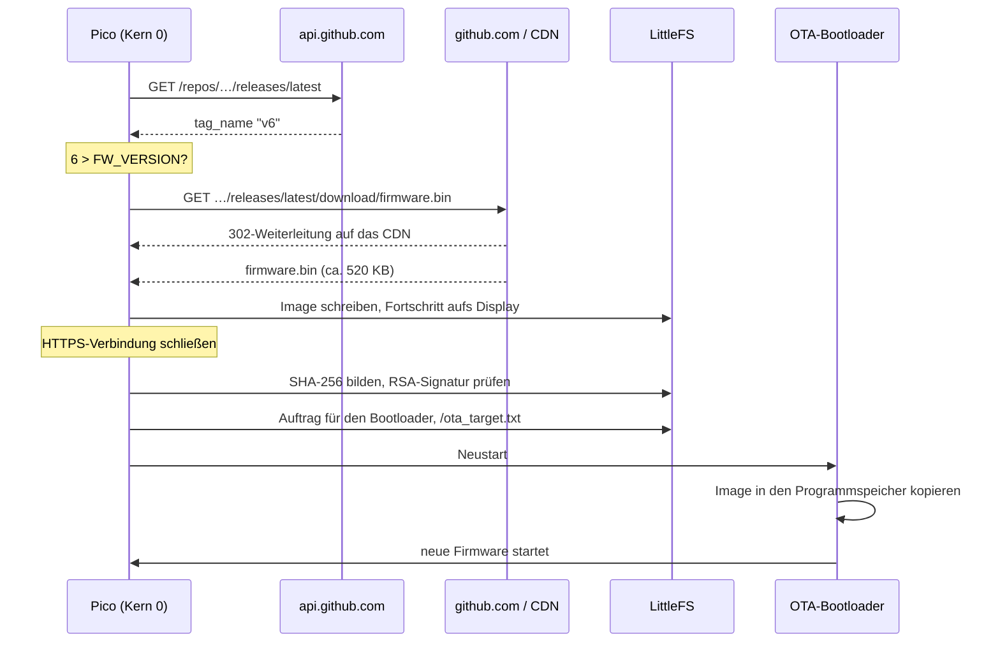

# OTA-Updates

Neue Firmware kommt auf zwei Wegen ohne USB-Kabel auf den Pico:

| | LAN-Upload | Internet-Update |
|---|---|---|
| Auslöser | Hochladen in der Arduino-IDE | der Pico selbst: 30 s nach dem Verbinden, dann alle 6 h, oder Befehl `update` |
| Quelle | der PC | das neueste Release dieses Repositorys |
| Reichweite | gleiches Netz wie der PC | überall mit Internet |
| Verbindung | IDE → Pico, Port 2040 | Pico → GitHub, HTTPS. Keine Portfreigabe im Router |
| Signatur nötig | ja | ja |
| Typischer Einsatz | Entwickeln und Testen | fertige Versionen verteilen |

Beide Wege schreiben das neue Image zuerst ins LittleFS. Erst nach erfolgreicher Prüfung kopiert
der OTA-Bootloader des Cores es beim nächsten Start in den Programmspeicher.

## Signatur

Der Pico nimmt nur Firmware an, die mit **deinem** privaten Schlüssel signiert ist (RSA-2048,
SHA-256). Ein unsigniertes oder fremd signiertes Image lehnt er mit Fehlercode 12 ab.

### Schlüssel erzeugen

Einmalig im Ordner `wlan-zeit/`:

```bash
openssl genrsa -out private.key 2048
openssl rsa -in private.key -pubout -out public.key
```

Mehr ist nicht nötig. Der arduino-pico-Core prüft bei jedem Kompilieren, ob die beiden Dateien im
Sketch-Ordner liegen:

- `public.key` vorhanden: Er baut den öffentlichen Schlüssel in die Firmware ein. Die IDE meldet
  `Enabling binary signing`.
- `private.key` vorhanden: Er signiert das fertige Image. Die IDE meldet `Signed binary: …`.
  Dazu muss `openssl` im Suchpfad liegen (unter Windows z. B. aus Git for Windows).

Ob die Signaturprüfung auf dem Pico aktiv ist, zeigt der Befehl `info`:

```
Signatur   aktiv (nur signierte Updates)
```

**Drei Regeln:**

1. `private.key` **nie** ins Repository. Sie steht deshalb in `.gitignore`.
2. `private.key` **sichern**. Ohne sie lässt sich keine Firmware mehr signieren, die der Pico
   annimmt; dann hilft nur ein Upload per USB.
3. **Keine neuen Schlüssel erzeugen.** Ein Pico, der mit dem alten öffentlichen Schlüssel läuft,
   lehnt alles ab, was mit einem neuen signiert ist. `public.key` lässt sich jederzeit aus
   `private.key` neu erzeugen (zweiter Befehl oben).

### platform.local.txt

Der Core legt die signierte Firmware als `.bin.signed` neben die unsignierte `.bin`. Zwei Stellen
greifen aber auf die `.bin` zu:

- der **Netzwerk-Upload der IDE**: Er würde die unsignierte Datei schicken, die der Pico ablehnt.
- die IDE 1.8 legt beim **Exportieren** ohnehin nur die `.uf2` in den Sketch-Ordner, keine `.bin`.

`tools/platform.local.txt` ergänzt den Build um einen Schritt: Bei einem signierten Build ersetzt
er die `.bin` durch die signierte Version und kopiert sie zusätzlich als **`firmware.bin`** in den
Sketch-Ordner. Ohne `private.key` passiert nichts, und eine alte `.bin.signed` aus einem früheren
Build wird nie verwendet.

Ablage (Versionsordner anpassen, nach jedem Update des Cores neu hineinkopieren, dann die IDE neu
starten):

| Installation | Ordner |
|---|---|
| Arduino-IDE als Snap (Ubuntu) | `~/snap/arduino/current/.arduino15/packages/rp2040/hardware/rp2040/<version>/` |
| Linux | `~/.arduino15/packages/rp2040/hardware/rp2040/<version>/` |
| Windows | `%LOCALAPPDATA%\Arduino15\packages\rp2040\hardware\rp2040\<version>\` |
| macOS | `~/Library/Arduino15/packages/rp2040/hardware/rp2040/<version>/` |

## Ein Release veröffentlichen

1. `FW_VERSION` im Sketch um 1 erhöhen, z. B. auf `6`.
2. Kompilieren (Haken in der IDE). Danach liegt die signierte `firmware.bin` im Sketch-Ordner.
3. Auf GitHub ein Release anlegen:
   - **Tag:** `v6`, also `v` + `FW_VERSION`
   - **Anhang:** nur `firmware.bin`
   - **nicht** als Pre-Release markieren; Pre-Releases zählen nicht als „latest“

   Mit der GitHub-CLI geht das in einem Schritt:
   ```bash
   gh release create v6 firmware.bin --title "v6"
   ```
4. Der Pico holt sich das Update bei der nächsten Prüfung. Sofort geht es mit `update` im
   seriellen Monitor oder durch kurzes Trennen vom Strom.

Ein leeres Repository hat keinen Bereich *Releases*. Es braucht mindestens eine Datei, z. B. dieses
README. Ob ein Release gefunden wird, lässt sich im Browser prüfen:
`https://github.com/Neon153/Pico2W-NTP-Uhr/releases/latest/download/firmware.bin` muss den
Download starten.

Das Repository muss **öffentlich** sein. Release-Anhänge privater Repositorys sind nur mit Token
erreichbar, und ein Token gehört nicht in eine Firmware.

## Versionslogik

- Der Pico fragt über die GitHub-API (`/repos/…/releases/latest`) den Tag des neuesten Releases ab
  und liest die Zahl daraus: `v6` → 6, `v6.1` → 6.
- Er lädt nur, wenn diese Zahl **größer** als seine eigene `FW_VERSION` ist. Ältere oder gleiche
  Versionen ignoriert er.
- **Schutz vor Update-Schleifen:** Vor dem Neustart schreibt der Pico die Zielversion nach
  `/ota_target.txt`. Meldet die neue Firmware danach eine kleinere `FW_VERSION` (Zahl im Sketch
  vergessen zu erhöhen), lädt er dieses Release nicht noch einmal und schreibt eine Warnung in den
  seriellen Monitor.
- **Testbuilds per LAN-Upload oder USB** brauchen eine `FW_VERSION`, die mindestens so hoch ist wie
  das neueste Release. Sonst holt sich der Pico nach 30 s das Release zurück, und die eigenen
  Änderungen scheinen „ignoriert“ zu werden. Alternativ während der Entwicklung
  `#define UPDATE_REPO ""` setzen.
- Für die Update-Prüfung zählt der Code, der **auf dem Pico läuft**, nicht der heruntergeladene.
  Ein Release, das mit älterem Code gebaut wurde, bringt dessen Fehler wieder mit.

GitHub erlaubt ohne Anmeldung 60 API-Abfragen pro Stunde und IP-Adresse. Bei einer Prüfung alle
6 Stunden spielt das keine Rolle; das Intervall sollte aber nicht unter einige Minuten sinken.

## Ablauf eines Internet-Updates



Der serielle Monitor protokolliert jeden Schritt (Zahlen durch `…` ersetzt):

```
[OTA]  Pruefe https://api.github.com/repos/Neon153/Pico2W-NTP-Uhr/releases/latest
[OTA]  neuestes Release: Tag "v6"
[OTA]  installiert v5, verfuegbar v6
[OTA]  Lade https://github.com/Neon153/Pico2W-NTP-Uhr/releases/latest/download/firmware.bin
[OTA]  firmware.bin: … Bytes
[OTA]  … von … Bytes gespeichert, Verbindung geschlossen
[OTA]  Thunk-Stack bisher max. … von 6400 Bytes
[OTA]  pruefe Signatur ...
[OTA]  Signaturpruefung ok, Update bereitgestellt (Fehler 0)
[OTA]  Neustart, der Bootloader kopiert jetzt die neue Firmware (ca. 10 s)
```

Laut Dokumentation des Cores übersteht das Update einen Stromausfall: Der Auftrag an den
Bootloader liegt im Flash, und nach dem Wiedereinschalten beginnt der Bootloader von vorn.

### Warum kein HTTPUpdate

Die erste Version nutzte die Bibliotheksfunktion `httpUpdate.update()` des Cores. Sie lädt,
prüft und legt das Image in einem Aufruf ab und schließt die HTTPS-Verbindung erst danach. Damit
blieb der Pico nach dem Download reproduzierbar bei der Signaturprüfung hängen.

Die genaue Ursache ist nicht nachgewiesen. Wahrscheinlich ist ein Überlauf des sogenannten
Thunk-Stacks: einem separaten Stapelspeicher von 6400 Bytes, den die Verschlüsselung und die
Signaturprüfung gemeinsam nutzen. Die eigene Funktion `downloadFirmware()` schließt die
Verbindung deshalb **vor** der Prüfung und protokolliert jeden Schritt. Seitdem läuft das Update
durch. Die Zeile `Thunk-Stack bisher max. … von 6400 Bytes` im Protokoll zeigt, wie viel davon
die Übertragung belegt hat.

## LAN-Upload aus der Arduino-IDE

Sobald der Pico im WLAN ist, erscheint er in der IDE unter *Werkzeuge → Port → Netzwerkports* als
`pico2w-uhr at 192.168.x.y`. Hochladen funktioniert dann wie per USB, nur über das Netz. Ohne
`tools/platform.local.txt` würde die IDE dabei die unsignierte `.bin` schicken, siehe
[oben](#platformlocaltxt).

Ein Passwort für den LAN-Upload setzt der Befehl `otapw`. Es wirkt erst nach einem Neustart, den
der Befehl selbst auslöst. Den Port 2040 **nie** im Router freigeben: ArduinoOTA schützt das
Passwort nur mit MD5 und ist für das lokale Netz gedacht.

## Sicherheit

- **Echtheit:** prüft die RSA-Signatur. Die HTTPS-Verbindung zu GitHub läuft deshalb ohne
  Prüfung des Serverzertifikats (`setInsecure()`); Zertifikate von GitHub und dem CDN wechseln, und
  eingebaute Zertifikate würden irgendwann ablaufen.
- **Was ein Angreifer im Netz erreichen kann:** ein Update verhindern oder eine **ältere**, von dir
  signierte Firmware unterschieben. Eigenen Code kann er nicht einspielen.
- **Keine Geheimnisse in der Firmware:** WLAN-Daten und OTA-Passwort liegen im LittleFS des Pico,
  nicht im Image. `firmware.bin` kann deshalb öffentlich im Release liegen.
- **Physischer Zugriff:** Wer den Pico per USB ausliest, kommt an die WLAN-Daten im LittleFS.

## Grenzen

- **Kein automatisches Zurückrollen.** Startet eine neue Firmware, kommt aber nicht mehr ins WLAN
  oder hängt beim Update, hilft nur ein Upload per USB. Neue Versionen deshalb erst per LAN-Upload
  testen und dann als Release veröffentlichen.
- Das Flash ist zweigeteilt (2 MB Programm, 2 MB Dateisystem). Ein Image darf höchstens so groß sein,
  wie im Dateisystem frei ist; derzeit sind es rund 520 KB.
- Zwischen zwei Prüfungen vergehen bis zu 6 Stunden, wenn man nicht `update` eingibt oder den Pico
  neu startet.
