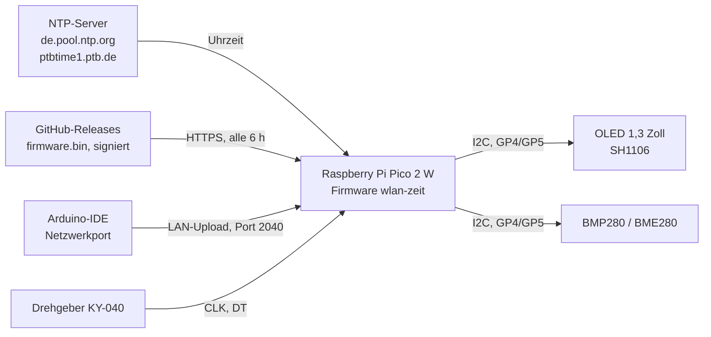

<<<<<<< HEAD
# Pico2W-NTP-Uhr – Raspberry Pi Pico 2 W + 1,3"-OLED + OTA-Updates

Eine Uhr auf dem **Raspberry Pi Pico 2 W**, die sich die Zeit per **NTP** aus dem Internet holt und
auf einem **1,3"-OLED** (SH1106, 128 × 64, I2C) anzeigt. Ein **BMP280/BME280** misst Temperatur und
Luftdruck, ein **Drehgeber** schaltet zwischen den Seiten um. Neue Firmware kommt **ohne USB-Kabel**
auf den Pico: aus der Arduino-IDE übers WLAN oder automatisch aus den GitHub-Releases dieses
Repositorys, in beiden Fällen nur mit gültiger **RSA-Signatur**.


## Funktionen

- **Uhrzeit per NTP** (`de.pool.ntp.org`, `ptbtime1.ptb.de`), stündlicher Abgleich,
  **MEZ/MESZ mit automatischer Sommerzeit**
- **Drei Seiten**, umschaltbar mit dem Drehgeber: Uhr, Klima, Tulpe
- **Klima-Seite:** Temperatur, Luftdruck und, mit einem BME280, Luftfeuchte.
  Ob BMP280 oder BME280 angeschlossen ist, erkennt die Firmware selbst.
- **Internet-Update:** Der Pico prüft nach dem Verbinden und dann alle 6 Stunden das neueste
  GitHub-Release, lädt `firmware.bin`, prüft die Signatur und startet neu. Keine Portfreigabe im
  Router nötig.
- **LAN-Upload** direkt aus der Arduino-IDE über den Netzwerkport `pico2w-uhr`
- **Signierte Firmware:** Der Pico nimmt nur Images an, die mit dem eigenen privaten Schlüssel
  signiert sind.
- **Keine Zugangsdaten im Programm:** WLAN-Name und Passwort liegen im Dateisystem des Pico.
  Die Firmware kann deshalb öffentlich auf GitHub liegen.
- **Uhr läuft immer weiter:** WLAN und Updates laufen auf Kern 0, Display, Sensor und Drehgeber auf
  Kern 1. Auch während eines Reconnects oder Downloads tickt die Anzeige.
- Fortschrittsbalken beim Update, Statusanzeige bis zur ersten Synchronisation,
  serielle Befehle zur Einrichtung und Diagnose

| Klima | Tulpe | Update |
|---|---|---|
|  |  |  |

## Systemüberblick



## Projektstruktur

```
wlan-zeit/
  wlan-zeit.ino            Firmware (Arduino-Sketch, Ordnername = Sketchname)
  private.key, public.key  Signaturschlüssel, NICHT im Repository (siehe docs/ota.md)
tools/
  platform.local.txt       Ergänzung für den Pico-Core: signierte Netzwerk-Uploads, firmware.bin
docs/                      Ausführliche Dokumentation
```

## Schnellstart

1. **Hardware anschließen.** Siehe [docs/hardware.md](docs/hardware.md). Alle Module an **3V3**,
   nicht an 5 V.
2. **Arduino-IDE einrichten:** Boardpaket *Raspberry Pi Pico/RP2040/RP2350* von Earle F. Philhower
   (Boardverwalter-URL
   `https://github.com/earlephilhower/arduino-pico/releases/download/global/package_rp2040_index.json`),
   Bibliothek **U8g2** über den Bibliotheksverwalter.
3. **Werkzeuge-Menü einstellen:**
   - Board: *Raspberry Pi Pico 2W*
   - Flash Size: **4MB (Sketch: 2MB, FS: 2MB)** (ohne Dateisystem kein OTA)
   - WiFi Region: **Germany**
4. **Signaturschlüssel erzeugen** im Ordner `wlan-zeit/`:
   ```bash
   openssl genrsa -out private.key 2048
   openssl rsa -in private.key -pubout -out public.key
   ```
   `private.key` sichern und **nie** hochladen. Danach `tools/platform.local.txt` in den Ordner des
   Cores kopieren, siehe [docs/ota.md](docs/ota.md#signatur).
5. **Erster Upload per USB:** BOOTSEL gedrückt halten, Pico einstecken, Port *UF2 Board* wählen,
   hochladen.
6. **WLAN einrichten:** seriellen Monitor öffnen (115200 Baud, „Neue Zeile“), `wifi` eingeben,
   dann SSID und Passwort. Die Uhr verbindet sich und zeigt nach wenigen Sekunden die Zeit.

Unter Linux braucht der Benutzer Zugriff auf den seriellen Port:
`sudo usermod -aG dialout $USER`, danach neu anmelden.

**Ab jetzt ohne Kabel:** Neue Versionen über *Werkzeuge → Port → pico2w-uhr* hochladen oder als
GitHub-Release veröffentlichen, siehe [docs/ota.md](docs/ota.md#ein-release-veröffentlichen).

## Dokumentation

| Dokument | Inhalt |
|---|---|
| [Hardware](docs/hardware.md) | Teile, Verdrahtung, Display-Controller, BMP280 vs. BME280, Drehgeber, Platzierung des Sensors |
| [Firmware](docs/firmware.md) | Aufteilung auf die Kerne, Zeit und Zeitzone, WLAN, Display, Sensor-Treiber, Drehgeber, serielle Befehle, Konfiguration |
| [OTA-Updates](docs/ota.md) | Signatur und Schlüssel, Release veröffentlichen, Versionslogik, Ablauf eines Updates, Sicherheit, Grenzen |
| [Fehlersuche](docs/fehlersuche.md) | Typische Fehlerbilder bei Build, Upload, Display, WLAN, OTA, Sensor und Drehgeber |
| [Entstehung (Prompts)](docs/prompts.md) | Die Prompts, mit denen das Projekt zusammen mit Claude entstanden ist, und was jeweils dabei herauskam |

## Projektstatus

- Der Sketch kompiliert mit dem arduino-pico-Core 6.4.0 für den Pico 2 W ohne Warnungen:
  518 KB Flash, 76 KB statischer RAM von 512 KB.
- **Auf der Hardware getestet:** Uhrzeit per NTP auf dem OLED, signierte Firmware, ein
  Internet-Update über GitHub-Releases mit dem aktuellen Download-Code. Dass mehrere Updates
  hintereinander zuverlässig durchlaufen, ist noch nicht bestätigt.
- **Noch nicht auf Hardware getestet:** LAN-Upload aus der IDE, Klima-Seite mit BMP280/BME280,
  Drehgeber, Tulpen-Seite. Die Umrechnung der Sensorwerte ist gegen das Rechenbeispiel im
  Bosch-Datenblatt geprüft (25,08 °C, 100 653 Pa).
- Die Display-Bilder in dieser Dokumentation sind mit dem Zeichencode der Firmware und der
  U8g2-Bibliothek am PC gerendert, keine Fotos.
- Das Repository hat noch keine Lizenz.
=======
OTA-TEST
>>>>>>> 421b8f189ede12fca6d72e33058162bd2cd6953b
